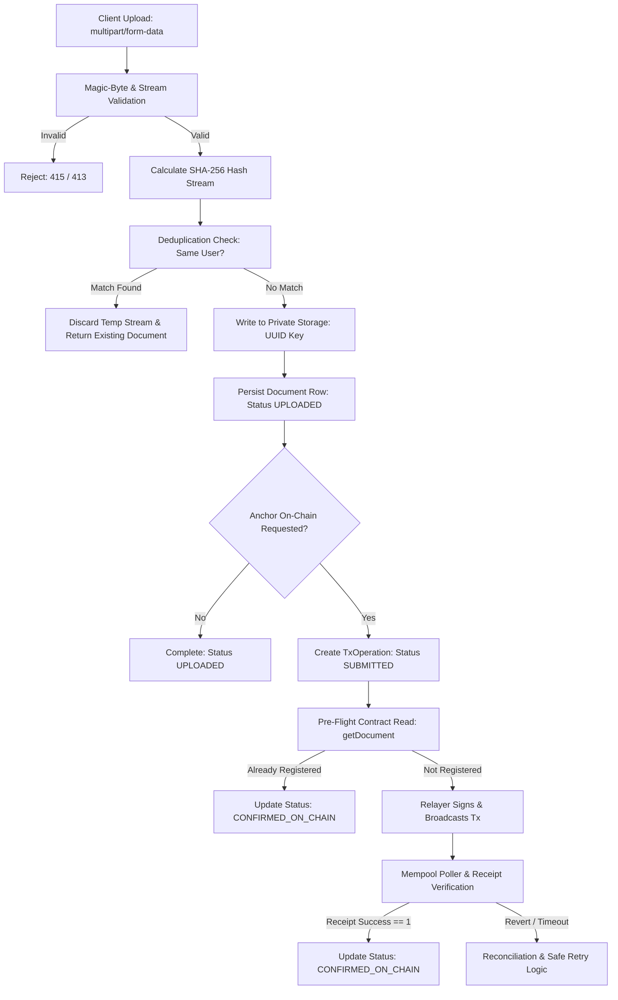

# Layer 1 SOP: Document Lifecycle Specification
**SOP ID:** SOP-ARCH-001  
**Category:** Core Business Logic & State Transitions  
**Status:** PROPOSED (Phase 3A Review)  
**Last Updated:** 2026-10-11  

---

## 1. Objective
Define the deterministic end-to-end lifecycle of a digital document within ProofVault—from multipart ingestion and streaming cryptographic fingerprinting to blockchain anchoring, verification, public visibility toggling, revocation, and deletion.

---

## 2. Preconditions & Actor Permissions
- User is authenticated with a valid JWT Bearer token issued by `/api/v1/auth/login`.
- Target file is within supported MIME types (`application/pdf`, `image/png`, `image/jpeg`, DOCX) and $\le 25\text{ MB}$.
- Host private file storage directory is writable.
- PostgreSQL database is reachable.

---

## 3. Lifecycle Phases & Execution Steps

### 3.1 Step 1: Ingestion & Streaming Cryptographic Hashing
1. **Streaming Ingestion:** `multer` receives `multipart/form-data` with streaming limits.
2. **Magic-Byte Sniffing:** The first 4,100 bytes are inspected via `file-type` to detect true binary headers. Mismatches against declared MIME type immediately abort the stream.
3. **Canonical SHA-256 Hashing:** Node.js native `crypto.createHash('sha256')` computes the hash directly across the stream. Memory consumption remains $O(1)$.
4. **Digest Representation:** Output digest is formatted as a 64-character lowercase hex string (`sha256Hash`), matching Solidity `bytes32`.

### 3.2 Step 2: Deduplication Evaluation
1. **Same-User Lookup (Decision Q1):** Query `Document` where `ownerId = currentUserId`, `sha256Hash = computedHash`, and `isDeleted = false`.
   - If found: Ephemeral upload file is unlinked immediately. Return existing document payload (`200 OK` or `409 Conflict`). No new on-chain transaction is queued.
2. **Cross-User Handling (Decision Q2):** If another user owns the same hash, User B receives a new `documentId` and independent `storageKey`. No cross-user duplicate info is leaked.

### 3.3 Step 3: Private Storage & Database Persistence
1. **Isolated Storage:** File written to `./temp/storage/<storageKey>` (or encrypted S3). Storage keys are unguessable UUIDv4 strings. Files are never stored under original file names or accessible via public URLs.
2. **Database Record:** Insert into `Document` table with `registrationStatus = UPLOADED`.

### 3.4 Step 4: Blockchain Anchoring (Relayer Model)
1. **Key Derivation:** Calculate unique on-chain key:
   $$\text{documentKey} = \text{keccak256}(\text{bytes}(\text{documentId}))$$
2. **Pre-Flight Check:** Call `ProofVault.getDocument(documentKey)` on-chain. If already registered, transition to `CONFIRMED_ON_CHAIN`.
3. **Broadcast:** If not registered, relayer signs and broadcasts `registerDocument(documentKey, bytes32(sha256Hash))`.
4. **Receipt Validation:** Poller monitors transaction hash. When receipt status equals `1` and confirmations meet threshold (`CONFIRMATION_THRESHOLD`), database transitions to `CONFIRMED_ON_CHAIN`.

### 3.5 Step 5: Verification (Private & Public)
1. **Private Verification:** Authenticated user submits a candidate file against `documentId`. The server recomputes the candidate SHA-256 and compares it against both the database record and on-chain contract state.
2. **Public Verification (Decision Q7 & Q8):** If `visibility == PUBLIC_VERIFIABLE`, verifiers access `/api/v1/public/verify/:token`. Only sanitized public fields (Title, Hash, Chain ID, Contract Address, Tx Hash, Timestamp) are displayed. Candidate files uploaded by public verifiers are hashed in-memory and discarded immediately.

### 3.6 Step 6: Revocation & Deletion
1. **Public Visibility Revocation:** Owner toggles visibility back to `PRIVATE`. The `publicVerificationToken` is nullified; public endpoint returns `404 Not Found`.
2. **On-Chain Revocation:** If requested, relayer submits `revokeDocument(documentKey, reason)`. Contract sets `isRevoked = true` and emits `DocumentRevoked`.
3. **Off-Chain Deletion (Decision Q9):** Owner executes document deletion. File bytes are permanently unlinked from storage; database record is soft-deleted; user is explicitly warned that immutable on-chain proofs cannot be erased.

---

## 4. Edge Cases & Validation Rules
- **Corrupt Stream:** If client disconnects midway, upload stream is aborted and partially written files in `temp/` are cleaned up in a `finally` block.
- **RPC Outage During Upload:** File remains safely stored in `UPLOADED` status; owner can trigger on-chain anchoring later via `POST /api/v1/documents/:id/register-on-chain`.
