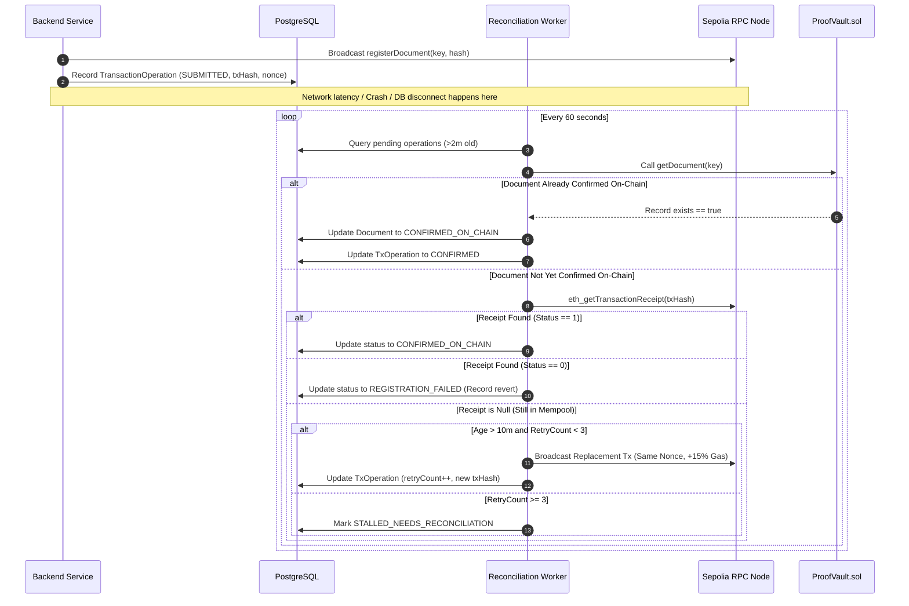

# Layer 1 SOP: Transaction Reconciliation & Self-Healing Engine
**SOP ID:** SOP-ARCH-002  
**Category:** Blockchain Reliability & Fault Tolerance  
**Status:** PROPOSED (Phase 3A Review)  
**Last Updated:** 2026-10-11  

---

## 1. Objective
Establish deterministic procedures for handling asynchronous EVM blockchain transactions, handling mempool delays without duplicate spending, and recovering from process crashes or interrupted database writes.

---

## 2. Core Operational Principle: Timeout $\neq$ Failure
In public blockchain networks (such as Ethereum Sepolia), a delay or timeout of 5 to 15 minutes **does not constitute transaction failure**. During gas volatility or network congestion, transactions often remain pending in node mempools. Treating a timeout as a failure risks nonce desynchronization, double-spending relayer gas, or corrupting state.

---

## 3. The 4-Stage Reconciliation Workflow

---

## 4. Execution Step Rules

### Step 1: Pre-Flight Contract Verification (Before Broadcast or Retry)
Before broadcasting any transaction or replacement:
1. Call read-only function `ProofVault.getDocument(documentKey)`.
2. If `exists == true` and `documentHash == expectedHash`:
   - An earlier transaction succeeded or was mined.
   - Do **NOT** broadcast any new transaction.
   - Idempotently update database record to `CONFIRMED_ON_CHAIN` and log reconciliation event.

### Step 2: Nonce and Mempool Management
1. The Relayer service maintains a persistent Mutex lock over the current account nonce.
2. If replacing a stuck transaction:
   - Must use the **exact same nonce**.
   - Must increase both `maxFeePerGas` and `maxPriorityFeePerGas` by at least 15% (satisfying EIP-1559 mempool replacement rules).
   - Maximum automated retries: **3**.

### Step 3: Receipt Validation Criteria
A transaction is marked `CONFIRMED` only when all of the following conditions are validated:
1. `receipt != null`
2. `receipt.status == 1` (Not reverted)
3. `receipt.to.toLowerCase() == CONTRACT_ADDRESS.toLowerCase()`
4. Block confirmations satisfy threshold:
   $$\text{currentBlock} - \text{receipt.blockNumber} + 1 \ge \text{CONFIRMATION\_THRESHOLD}$$
5. Receipt event log contains topic matching `DocumentRegistered(documentKey, documentHash, issuer, timestamp)`.

### Step 4: Crash Recovery (Mined On-Chain, DB Update Failed)
If the backend process crashed immediately after the transaction was broadcast:
1. Upon restart, the Reconciliation Worker identifies records in `SUBMITTED_TO_CHAIN` status.
2. The worker retrieves the on-chain receipt and event logs using the stored `txHash`.
3. If confirmed, it writes the missing `BlockchainRegistration` row and updates `Document` status to `CONFIRMED_ON_CHAIN`.
4. If `txHash` was lost before DB write, the worker scans the latest 500 blocks for `DocumentRegistered` events where `issuer == relayerAddress` to re-bind orphaned transactions to the matching `documentKey`.

---

## 5. Security & Safety Boundaries
- **No Unbounded Retries:** After 3 retries, status is set to `STALLED_NEEDS_RECONCILIATION`. The system alerts administrators; it does not drop state or consume further gas.
- **Gas Reserve Protection:** Relayer asserts balance $\ge 0.05\text{ ETH}$ before initiating transactions.
