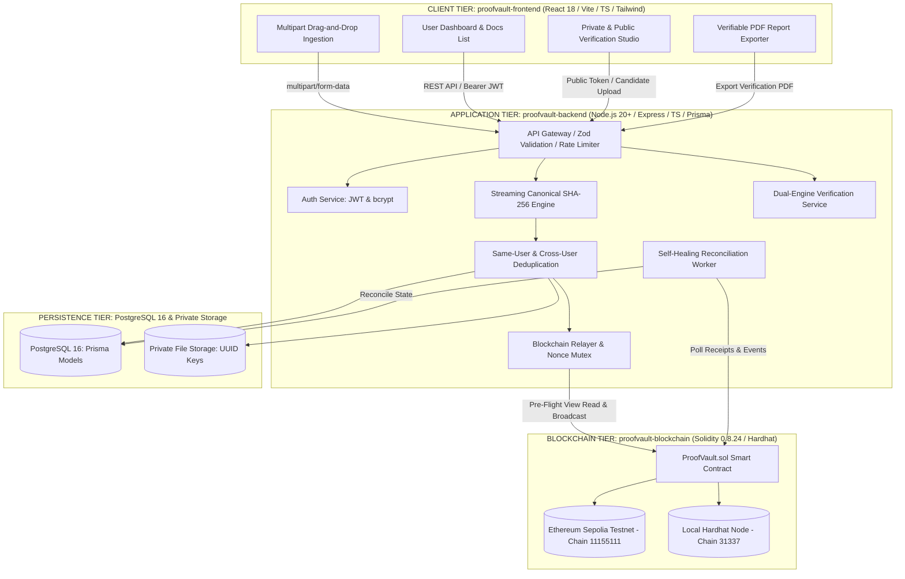
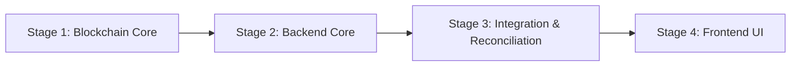

# ProofVault — Phase 3A Architecture Review & Technical Plan
**Document ID:** PV-ARCH-REVIEW-001  
**Protocol Phase:** Phase 3A — Architect (Architecture Planning & Boundary Review)  
**Execution Date:** 2026-10-11  
**Status:** PROPOSED & REVIEWED (Awaiting Human Approval for Phase 3B Scaffolding)  

---

## 1. System Architecture & Topology Diagram

ProofVault implements the **A.N.T. Three-Layer Architecture** across three decoupled codebases:

---

## 2. Component Responsibility & Boundary Map

| Component / Subsystem | Primary Responsibilities | Strict Non-Responsibilities & Boundaries |
| :--- | :--- | :--- |
| **`proofvault-frontend/`** | UI presentation, form input validation, streaming progress bars, honest transaction spinners, QR code rendering, client PDF export. | **Untrusted boundary.** Never stores private signing keys; never calculates authoritative document hashes; never declares transactions confirmed without backend validation. |
| **`proofvault-backend/`** | Authoritative canonical SHA-256 byte hashing, BOLA authorization guards, relayer transaction broadcast, mempool monitoring, reconciliation worker. | Does not store plain text passwords; does not expose private file paths or storage keys in API responses; does not drop state on timeouts. |
| **PostgreSQL 16 (Prisma)** | Persistent storage of user accounts, document metadata, transaction attempts (`TransactionOperation`), confirmed receipts, and application audit trails. | Not authoritative for on-chain state; never treated as an atomic single transaction with blockchain execution. |
| **Private File Storage** | Secure filesystem (or S3) repository storing raw document bytes using randomized UUIDv4 storage keys. | Files are never served via public static endpoints; never indexed by search engines; purged permanently on document deletion. |
| **`proofvault-blockchain/`** | Immutable proof registry (`ProofVault.sol`), recording 32-byte document keys, 32-byte hashes, block timestamps, and issuer addresses. | Never stores files, usernames, filenames, or private metadata. Issuer address is the relayer wallet, not user identity. |

---

## 3. End-to-End Document Lifecycle Flow

1. **Ingestion & Validation:** File received via `multipart/form-data`. Streaming `file-type` header check validates magic numbers against permitted whitelist (PDF, PNG, JPG, DOCX). Size capped at 25 MB.
2. **Canonical Hashing:** Node.js native `crypto.createHash('sha256')` calculates digest directly from byte stream.
3. **Deduplication Check (Decisions Q1 & Q2):**
   - **Same User:** If current user already owns identical hash, upload is discarded and existing document record returned. Zero duplicate storage or blockchain spend.
   - **Different User:** If another user owns hash, a distinct document record is created with independent UUID keys. Zero cross-user data is disclosed.
4. **Private Storage:** File written to `./temp/storage/<storageKey>` using randomized UUIDv4 key.
5. **On-Chain Anchoring (Decision Q3):**
   - Key derived: $\text{documentKey} = \text{keccak256}(\text{bytes}(\text{documentId}))$.
   - Pre-flight check: Call `getDocument(documentKey)`. If already registered, mark `CONFIRMED_ON_CHAIN`.
   - Broadcast: Relayer signs and broadcasts `registerDocument(documentKey, documentHash)` to Sepolia.
6. **Transaction Confirmation (Decision Q10):**
   - Poller monitors receipt. When `receipt.status == 1`, contract address matches, and confirmations $\ge \text{CONFIRMATION\_THRESHOLD}$, status transitions to `CONFIRMED_ON_CHAIN`.
7. **Verification (Private & Public):**
   - Private verification re-hashes uploaded candidate file and cross-checks DB and smart contract.
   - Public verification operates via unguessable token (`publicVerificationToken`) exposing sanitized DTO only.
8. **Revocation & Deletion (Decisions Q7 & Q9):**
   - Visibility revoked: token nullified; public verification returns `404 NOT_FOUND`.
   - On-chain revocation: relayer calls `revokeDocument(documentKey, reason)`.
   - Document deletion: file bytes purged from disk; DB row soft-deleted; user warned that on-chain proof is permanent.

---

## 4. Error Handling & Transaction Reconciliation Strategy

### Core Axiom: Mempool Timeout $\neq$ Transaction Failure
In public blockchain networks, transactions can remain pending in mempools for over 10 minutes during gas volatility without being dropped. Treating a timeout as a failure causes duplicate spends, out-of-order nonces, and desynchronization.

### Reconciliation Worker Protocol
1. **Periodic Scan:** Worker runs every 60 seconds scanning `TransactionOperation` records $> 2\text{ minutes}$ old.
2. **Contract State Pre-Flight:** Worker calls `ProofVault.getDocument(documentKey)`. If on-chain existence is verified, state transitions to `CONFIRMED_ON_CHAIN` immediately without sending any replacement transaction.
3. **Mempool Inspection:** If not confirmed, queries RPC node:
   - `receipt != null && status == 1`: Marks confirmed.
   - `receipt != null && status == 0`: Marks failed (records revert error).
   - `receipt == null` (Still pending):
     - If pending $> 10\text{ minutes}$ and `retryCount < 3`: Replaces transaction with exact same nonce, increasing gas fees by 15% (EIP-1559 compliance).
     - If `retryCount >= 3`: Transitions to `STALLED_NEEDS_RECONCILIATION` and alerts operator without dropping data.
4. **Crashed Database Write Recovery:** If the server crashed after an on-chain transaction was broadcast, the worker queries historical contract events matching the relayer address to re-bind orphaned transactions to the matching `documentKey`.

---

## 5. Security & Boundary Review

1. **Secret Management:** Relayer private key resides strictly in `.env` (untracked and ignored by `.gitignore` and `.dockerignore`). Never sent to client.
2. **Access Control (BOLA Protection):** Every database query strictly filters `WHERE id = :documentId AND ownerId = :currentUserId`. Unauthorized requests return `404 NOT_FOUND` to prevent ID harvesting.
3. **Zero Data Leakage:** Public verification endpoints return a strictly filtered DTO. Owner email, real name, original filename, storage keys, and private audit history are never exposed.

---

## 6. Staged Implementation Sequence (Phase 3B Roadmap)

### Stage 1: Blockchain Foundation (`proofvault-blockchain/`)
- **Deliverables:** Hardhat project, `ProofVault.sol` contract, deployment scripts, unit & gas test suite.
- **Acceptance Criteria:** 100% test coverage on `ProofVault.sol` execution and revert conditions; gas benchmark $\le 65,000$ gas.

### Stage 2: Backend Core & Persistence (`proofvault-backend/`)
- **Deliverables:** Express + TypeScript project, Prisma schema, Docker database migrations, Auth service (JWT/bcrypt), streaming file ingestion & SHA-256 service.
- **Acceptance Criteria:** Zero lint/type errors; automated tests for magic-byte validation, 25 MB stream limits, and same-user deduplication.

### Stage 3: Blockchain Relayer & Self-Healing Worker (`proofvault-backend/`)
- **Deliverables:** `IBlockchainRelayer` implementation (ethers.js v6), nonce mutex lock, persistent `TransactionOperation` tracking, background Reconciliation Worker.
- **Acceptance Criteria:** Automated tests verifying receipt confirmation, 15% gas replacement on stuck transactions, and simulated crash recovery.

### Stage 4: Frontend Client & Public Verification Portal (`proofvault-frontend/`)
- **Deliverables:** React 18 + Vite + Tailwind CSS dashboard, drag-and-drop file upload, honest transaction state indicators, QR code renderer, and PDF report generator.
- **Acceptance Criteria:** Responsive UI across mobile/desktop; zero false-positive confirmation loaders; functional PDF report download.

---

## 7. Risk Analysis & Unresolved Nuances

| Risk Item | Likelihood | Impact | Architectural Mitigation |
| :--- | :--- | :--- | :--- |
| **Sepolia Faucet Depletion** | Medium | High | Relayer asserts minimum balance ($0.05\text{ ETH}$) at startup; tests default to local Hardhat node to conserve testnet ETH. |
| **Gas Volatility on Replacement** | Low | Medium | EIP-1559 15% gas bump is benchmarked against dynamic base fees to ensure transactions are mined during spikes. |
| **Orphaned Storage Files** | Low | Low | Upload streams utilize `try/finally` blocks to unlink uncommitted files in `./temp/storage/`. |

---

## 8. Conclusion
The ProofVault architecture is fully specified, internally consistent across all three codebases, and adheres strictly to the B.L.A.S.T. protocol and A.N.T. 3-layer architecture. No blockers remain. Phase 3A Architecture Planning is complete.
